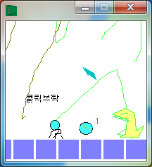

# 무제RPG

좌우 방향키로 움직이고 Z와 X로 공격하며 스페이스로 장전하는 사냥 RPG다. 사냥으로 모은 돈으로 쉴드를 사고 스킬 상인과 거래하는 것까지 넣었다.

  

## 플레이 방법

Releases에서 받아 실행하면 된다.

좌우 방향키로 움직이고 위아래는 화면의 버튼을 클릭해 옮겨 다닌다. Z와 X로 공격하고 스페이스를 누르면 장전한다. 사냥터에서 적을 잡으면 돈이 모이고, 마을에서 쉴드와 스킬을 살 수 있다.

## 구현 원리

공격 쿨다운을 알람 대신 오브젝트 충돌로 만들었다. 공격하면 캐릭터가 쿨다운 상태 오브젝트로 바뀌고, 스페이스로 장전하면 오브젝트 두 개가 서로 마주 보는 방향으로 속도 1로 출발한다. 둘이 만나 충돌 이벤트가 걸리는 순간이 쿨다운이 끝나는 시점이고, 이때 캐릭터를 다시 공격할 수 있는 오브젝트로 되돌린 뒤 자기 자신을 지운다. 두 오브젝트를 얼마나 떨어뜨려 놓느냐가 곧 쿨다운 시간이 되는 셈이다. 쉴드 쿨다운도 같은 방식으로 오브젝트 한 쌍을 더 만들어 처리했고, 쿨다운 중에 공격 키를 누르면 안내 문구가 뜨게 해뒀다.

## 파일

| 경로 | 내용 |
|---|---|
| `source/untitled-rpg.gmk` | 원본 프로젝트 파일 |
| `source/split/` | GmkSplitter로 분해한 텍스트 트리 |
| `docs/screenshots/` | 스크린샷 |
| Releases | 배포용 파일 |

## 라이선스

CC BY-NC-ND 4.0 라이선스다. 출처를 밝히면 비상업 용도로 그대로 공유할 수 있고, 수정본 배포와 상업적 이용은 금지한다. 함께 들어 있는 것 중 다른 사람이 만든 라이브러리와 그림·소리·맵은 각자의 권리를 따른다. 자세한 내용은 [LICENSE](LICENSE) 에 있다.
